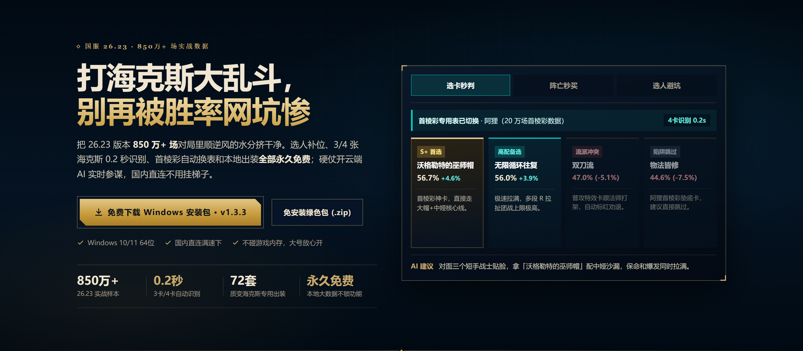
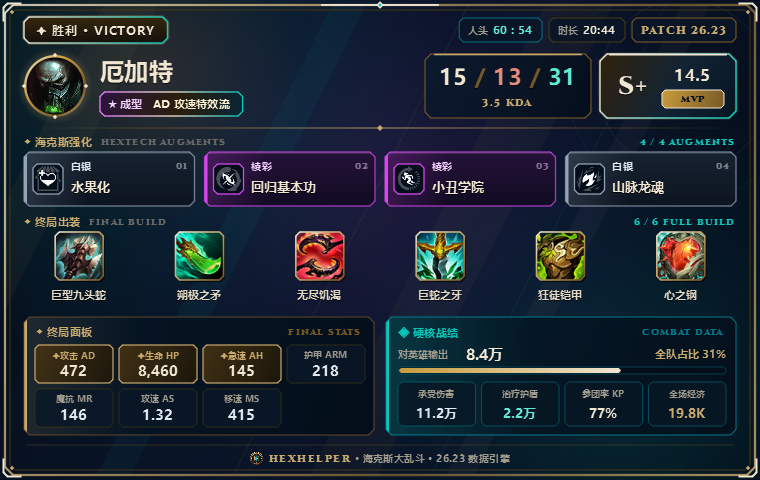

<div align="center">


# HexHelper · 海克斯大乱斗小助手

**为《英雄联盟》海克斯大乱斗打造的纯只读 Windows 桌面悬浮窗助手**

[](https://priswebtool.site)
[](https://priswebtool.site)
[](https://priswebtool.site)
[](LICENSE)

[**官网一键下载 Windows 安装包**](https://priswebtool.site) · [核心亮点](#核心亮点) · [安全说明](#跟-obs-录屏一样安全) · [从源码运行](#从源码运行)

</div>

---

<p align="center">
  
</p>

## 为什么做 HexHelper？

打海克斯大乱斗（ARAM: Mayhem）最容易踩的坑，往往来自直接照抄普通胜率网：

1. **反制装胜率被逆风局拖惨**：鬼书、反甲、兰顿、巨蛇之牙在普通榜单里胜率难看，不是装备弱，而是往往快输了才被迫买。我们基于 `26.23` 版本 **850 万+ 场**实战对局挤掉顺逆风水分，并合并大天使与叠满炽天使的统计，对面回血猛该出重伤就直接推。
2. **首棱彩局和常规局完全是两个节奏**：把 360 万场首棱彩局单独拆出来之后，不少常规局强卡胜率直接反转。HexHelper 认出第一轮全棱彩的瞬间自动切换首棱彩专用表，打完自动切回。
3. **新图 4 张海克斯不漏认不错位**：全自动兼容经典 3 卡与新图 4 卡界面，0.2 秒把每张卡的胜率、联动和流派冲突标在旁边，全是烂卡直接提醒摇骰子。

---

## 核心亮点

- **选人避坑 & 0ms 阵容补位**：内置 134 个英雄大乱斗隐藏平衡数值（增伤 / 承伤 / 治疗 / 护盾 / 极速 / 韧性），支持「上分 / 娱乐」双模式一键切换、备战席换人胜率差值与最优五人组合推荐，并支持只读十人大堂战绩雷达。
- **3/4 卡 0.2 秒识别与融合评分**：Windows 原生本地中文识别 + 图标核验，0.2 秒对齐 3 张或 4 张海克斯，首棱彩局自动换表，将海克斯联动加分与流派冲突警告直接融合标注在选卡界面上。
- **72 套质变海克斯出装**：收录小蜜蜂！！！、沃格勒特的巫师帽、死亡之环、没法力，没问题、虚幻武器、亮出你的剑等 72 套质变海克斯，选完自动切对应出装并在抽屉顶部弹出换装提示条；冲突卡直接标红劝退。
- **云端 AI 实时 10 人参谋**：国内免梯子直连，开箱即用无需任何复杂配置；开局 5 秒定思路、纠结选卡拍板、阵亡 2 秒按手里精准金币算好先买哪几件散件。
- **8 向自由拖拽缩放 & 4K 等比放大（v1.4.6）**：左右推荐悬浮窗支持完整 8 方向边角自由拖动调整尺寸，字号、装备图标与卡片间距随窗口真正等比缩放（`0.85x-2.20x`），4K 高分屏首次启动自动匹配清晰倍率，双击缩放把手或设置页一键重置；9 项常用操作支持游戏级自定义改键与冲突一键互换（默认 `F9` 一键收放左右浮窗）。
- **20 局滚动日志 & 一键问题反馈**：按局切片自动滚动保留最近 20 局运行日志（超 20 局自动清理最旧记录），遇识别异常或报错可一键脱敏压缩回传排查，也可导出本地日志包。
- **赛后海克斯战报卡**：对局结束自动生成 `760×430` 海克斯风战报图，一键复制直接发给开黑车队。

<p align="center">
  
</p>

---

## 永久免费与云端服务

- **本地大数据引擎永久免费不锁**：选人隐藏平衡与补位、3/4 卡 0.2 秒识别、首棱彩自动换表、流派冲突提醒、本地常规与反制出装、自定义快捷键和赛后战报卡全部永久免费使用，无广告、不弹窗。
- **云端 AI 参谋开箱即用**：内置官方免梯子高速线路，不用折腾任何代理或第三方配置；客户端内注册即赠 **450 积分**免费试玩，后续按局按实际消耗扣费，积分永不过期，余额用完仅暂停云端 AI，本地功能照常永久用。

---

## 跟 OBS 录屏一样安全

- **不改文件、不碰游戏内存**：仅通过 Riot 官方公开的本地只读接口与屏幕画面识别工作，不注入进程，不代你操作鼠标键盘。
- **不用管理员权限、零拖帧设计**：不装任何底层驱动；`v1.3.5` 起全悬浮窗采用紧凑包围盒（面积缩减 93%）、零 60fps 透明层刷屏与 DXGI 硬件采帧断线自愈，无边框窗口下叠窗不抢焦点、不掉 1% Low 帧率。

---

## 下载与快速上手

### 普通玩家（推荐）

前往官网 **[https://priswebtool.site](https://priswebtool.site)** 直接下载：
- **Windows 一键安装包（`.exe`）** 或 **免安装绿色包（`.zip`）**
- 国内高速直连，已内置 `26.23` 离线数据包与 126 个核心装备图标，装完打开就能打。

### 从源码运行

环境要求：Windows 10/11 64 位、Python `3.12+`

```powershell
git clone https://github.com/lanyard724/hex-helper.git
cd hex-helper

python -m venv .venv
.\.venv\Scripts\python.exe -m pip install -e ".[dev]"

# 启动桌面客户端
.\.venv\Scripts\python.exe -m hex_helper
```

运行单元测试：

```powershell
.\.venv\Scripts\pytest.exe tests/ -q
```

---

## 默认快捷键（全部可在设置里自定义）

| 默认按键 | 作用 |
| :---: | :--- |
| `F9` | 同时收起 / 展开左右双侧悬浮窗 |
| `F2` | 立即重扫当前 3 卡 / 4 卡海克斯 |
| `F3` | 收起 / 展开右侧出装与参谋抽屉 |
| `F7` | 收起 / 展开左侧海克斯联动浮窗 |
| `F4` | 临时隐藏 / 恢复全部局内浮窗 |
| `F6` | 手动呼叫一次实时 10 人局势分析 |
| `F8` | 框选校准卡片识别区域（适配带鱼屏） |

---

## 开源协议与免责声明

- 本仓库开源全部 Windows 桌面客户端源码，采用 [MIT License](LICENSE) 协议。
- 本项目为独立玩家社区工具，与 Riot Games 及腾讯游戏无任何官方隶属或合作关系。
